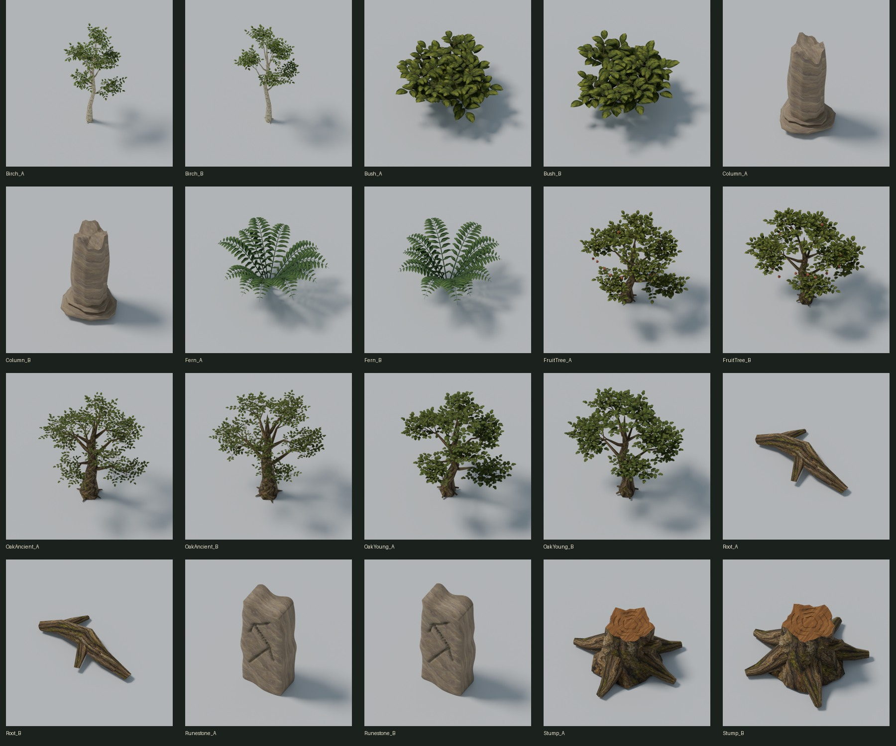
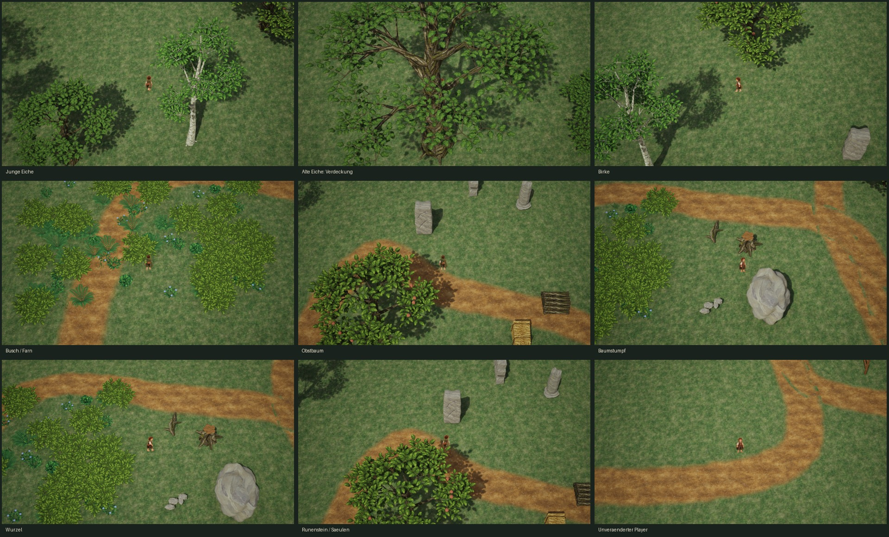

# Westland Asset Library – Art Quality V2 – Prüfbericht

Stand: 10.10.2026. Ausgangs-HEAD: `0add5a549bfc65c12529f46dfd60cb333213f321` – `Complete Westland asset library V1 tools and documentation`.

## Ergebnis und Freigabegrenze

Der Arbeitsbaum war anfangs sauber; V1 und die Westland Region waren gesichert. Genau 20 vorhandene A/B-Meshes wurden an den bisherigen FBX- und Unreal-Pfaden überarbeitet. Keine neuen Objekttypen, keine Regionsintegration. Blenderquelle gespeichert und erneut geöffnet; alle 20 Quellmeshes bestehen die Normalen-, Tangenten-, Binormalen-, UV- und Flächenprüfung. Der abschließende Reimport einschließlich LOD-Build enthält keine Normalen-/Binormalenwarnungen. Map Check: 0 Fehler / 0 Warnungen. Vollständiger Fußlauf und 38/38 PokeMonster-Automationstests bestanden.

Das ist eine technisch geprüfte Art-V2-Revision, keine finale visuelle Freigabe. Baumkronen, Blattverteilung, Wurzeln und Ruinen bleiben erkennbar einfacher und regelmäßiger als die verbindliche gemalte Westland-Referenz. `human_art_approval` bleibt false. Es wurden keine Details durch neue Objekttypen ersetzt oder Qualitätslücken durch niedrigere Grafikstufen kaschiert.

## Vorgaben, Quellen und unveränderte Bereiche

Gelesen: AGENTS, TECHNIK, GRAFIKSTIL, relevante ENTSCHEIDUNGEN, V1-Prüfbericht und Vorbereitungskatalog. Maßgeblich sind die Westland-Regionsillustration, die dokumentierte handgemalte Fantasywelt und das Heilhaus. Keine externen Downloads oder Marketplace-Assets.

Neue maßgebliche Blenderquelle: `Art/World/WestlandAssetLibrary/Source/WestlandAssetLibrary_V2.blend`. Die V1-Quelle bleibt bytegleich. Die 26 übrigen Bibliotheksmeshes und ihre FBX-Dateien bleiben bytegleich. Ursprünge, vorhandene UCX-Namen, Assetpfade, gemeinsame Materialmaster und die bisherigen Kollisionstypen bleiben erhalten.

Die eigene Testmap `Dev_WestlandAssetLibrary` enthält die vorhandene Anordnung. Änderungen an der Map: Art-V2-Tags an den 20 Revisionen und die Ausrichtung beider Runenstein-Vorderseiten zur Spielkamera. Endgültig Pitch 0°, Yaw 45°, Roll 0°. Keine Layout-, Licht-, HISM- oder Gameplay-Erweiterung. `Dev_WestlandRegion`, `Dev_TestMap`, alle Player-/Kamera-/Gameplay-Dateien bleiben bytegleich.

## Form- und Materialüberarbeitung

| Gruppe | Durchgeführte Änderung | Noch sichtbare Abweichung zur Referenz |
| --- | --- | --- |
| Alte/junge Eiche | Gebogene unregelmäßige Stämme, verzweigte Äste, Nebenäste und Zweige; gelappte einzelne Blätter; keine geschlossenen Kugelkronen. Alte Eiche mit breiter, asymmetrischer Krone. Zu große erste Blätter wurden nach Spielkamera-Sichtung verkleinert. | Kronen besonders der alten Eiche noch zu offen und in Astlagen gegliedert; Zweigverteilung stellenweise zu regelmäßig. Rindenkontrast stark. |
| Birke | Schlanker gebogener Stamm, heller bestehender Rindenanstrich, kleinere und leicht hängende Blattsprays, offene Silhouette. | Noch zu wenige unterschiedliche Hauptastgesten und zu gleichförmige Blattgruppen; nicht die reiche Krone der Illustration. |
| Obstbaum | Kompakte unregelmäßige Verzweigung, breite Blätter und vorhandene Früchte in einer lesbaren Silhouette. | Blätter weiterhin stark stilisiert; Früchte und Baumkrone brauchen später artgerichtete Gruppierung. |
| Busch | Mehrere geschwungene Triebe und individuell gebogene gemalte Blätter statt Kugelkörpern. A/B mit unterschiedlichen Phasen/Volumen. | Wiederholung der Blattform und ähnliche A/B-Gesamtsilhouette sichtbar; keine finale botanische Vielfalt. |
| Farn | Gebogene Wedel, paarige einzelne Fiederblätter, unregelmäßige Höhen und Öffnungswinkel. | Fiederabstände und Wedelstruktur noch regelmäßig; keine feinen botanischen Unterteilungen. |
| Stumpf | Unregelmäßiger Stammumfang, abgeflachte echte Schnittfläche, Holzringe und stumpfe Wurzelansätze; übertriebener erster Schnittspitz korrigiert. | Holzringoberfläche noch schematisch, Rinden-Wurzelübergänge und Alterung nicht final. |
| Wurzel | Niedrigere organische Verzweigung mit zwei statt vier starren Ausläufern; Bodenlage verbessert. | Wirkt teilweise noch wie ein liegender Ast; Erd-/Verwitterungsübergang fehlt. |
| Ruinensäule | Leicht unregelmäßige Kanneluren, dezente Bauchung, abgebrochene Oberkante und abgerundeter verwitterter Sockel. | Kanneluren und gemeinsames Steinmaterial noch zu gleichmäßig. Kein finaler Bewuchs. |
| Runenstein | Geschlossener unregelmäßiger Monolith, echte vertiefte Gravur mit dunklerem Vertexpigment; keine schwebenden Linien. Verschweißte Ränder, korrekte Flächenorientierung. | Gravurkanten noch zu scharf/stufig, Stein-/Moosvariation nicht so malerisch und reich wie die Referenz. |

Vier gemalte Blattfamilien: Eiche, Birke, Obstbaum, Farn. Selbst erzeugter Bitmap-Atlas; Herkunft/Prompt in `Textures/PROVENANCE.md`, mittels [imagegen-Skill](/Users/harry/.codex/skills/.system/imagegen/SKILL.md) erstellt. Vier Ausschnitte von jeweils 627×627 Pixel, ohne künstliches Upscaling; Mips und Texture Streaming aktiv. Je Material ein vorhandener Farbtextur-Sample, opak und zweiseitig. Keine Alpha-Overdraw-Karten, zusätzlichen Normalmaps oder neuen Materialmaster. Holz, Rinde, Birkenrinde und Stein werden weiterverwendet. Vier neue Materialinstanzen ersetzen mehrere ältere Blattsektionen in den Revisionen; alte Materialslot-Arrays bleiben aus Referenzschutz erhalten.

UV0 verwendet bewusst überlagertes Material-Tiling, keine einzigartige gebackene Textur pro Objekt. Keine degenerierten UV-Dreiecke. Lightmap-UV-Generierung ist beim Import aktiviert; der MeshDescription-Audit sieht einen Quell-UV-Kanal. Ein vollständig separat geprüfter Render-UV1-Unwrap wird hier nicht behauptet; die Testmap nutzt dynamische Beleuchtung. Keine normale Flächenprüfung wird durch diesen Hinweis ersetzt.

## Exakte Meshdaten

Maße: lokale Mesh-Bounds in Metern, X × Y × Z; keine Kronen-Collision. Slotzahl ist das erhaltene Assetslot-Array, Sektionen die tatsächlich belegten LOD0-Sektionen. Beide sind keine gemessenen Draw Calls. 18 Meshes über 1000 Dreiecken haben 3 LODs, ScreenSize 1 / 0,4 / 0,15, ungefähr 100 / 60 / 30 Prozent Dreiecke. Die beiden Wurzeln mit je 228 Dreiecken benötigen nur einen LOD.

| Asset | V1 LOD0 | V2 LOD0/1/2 | Bounds m | Slots / aktive Sektionen | UCX-Körper |
| --- | ---: | --- | --- | --- | ---: |
| Birch_A | 16364 | 28628/17177/8588 | 4.48 × 4.15 × 8.08 | 4 / 2 | 1 |
| Birch_B | 16364 | 28628/17176/8589 | 4.41 × 3.94 × 8.03 | 4 / 2 | 1 |
| Bush_A | 13426 | 7398/4439/2217 | 2.45 × 2.42 × 1.18 | 4 / 2 | 0 |
| Bush_B | 13426 | 7398/4439/2219 | 2.07 × 2.32 × 1.35 | 4 / 2 | 0 |
| Column_A | 776 | 1856/1113/556 | 1.00 × 0.95 × 1.98 | 2 / 2 | 1 |
| Column_B | 776 | 1856/1114/557 | 0.98 × 0.97 × 1.99 | 2 / 2 | 1 |
| Fern_A | 4212 | 8030/4818/2409 | 1.56 × 1.45 × 0.74 | 3 / 1 | 0 |
| Fern_B | 4212 | 8030/4818/2408 | 1.36 × 1.51 × 0.76 | 3 / 1 | 0 |
| FruitTree_A | 19724 | 35148/21089/10544 | 6.59 × 5.91 × 5.14 | 5 / 3 | 1 |
| FruitTree_B | 19724 | 35148/21089/10545 | 6.28 × 5.81 × 5.09 | 5 / 3 | 1 |
| OakAncient_A | 26720 | 36264/21759/10879 | 10.49 × 10.06 × 10.87 | 4 / 2 | 1 |
| OakAncient_B | 26720 | 36264/21759/10879 | 10.24 × 9.55 × 10.67 | 4 / 2 | 1 |
| OakYoung_A | 16364 | 28748/17249/8625 | 5.04 × 4.73 × 4.86 | 4 / 2 | 1 |
| OakYoung_B | 16364 | 28748/17249/8624 | 5.00 × 4.64 × 4.87 | 4 / 2 | 1 |
| Root_A | 251 | 228 | 1.72 × 1.02 × 0.25 | 1 / 1 | 0 |
| Root_B | 251 | 228 | 1.72 × 1.02 × 0.25 | 1 / 1 | 0 |
| Runestone_A | 1342 | 6464/3878/1940 | 0.99 × 0.63 × 2.28 | 2 / 1 | 1 |
| Runestone_B | 1342 | 6464/3878/1940 | 0.99 × 0.63 × 2.28 | 2 / 1 | 1 |
| Stump_A | 1208 | 1988/1192/597 | 1.64 × 1.50 × 0.84 | 3 / 3 | 1 |
| Stump_B | 1208 | 1988/1192/596 | 1.49 × 1.48 × 0.84 | 3 / 3 | 1 |

20 Revisionen zusammen: 309504 LOD0-Dreiecke. Gesamte 46er Bibliothek: 373492 statt 264762 (+41,1 %). Das ist die Summe eindeutiger Assetgeometrie, keine Aussage über gleichzeitig sichtbare oder instanzierte Dreiecke. Distanzfelder der Revisionen deaktiviert, bestehende UCX unverändert. Kleiner Unterwuchs weiterhin ohne Kollision.

## Ursache der Importwarnungen und Korrektur

Der V1-Audit nach tatsächlicher Triangulierung fand Blatt-Corner-Normalen mit Länge 0 und dadurch Binormalen mit Länge 0 trotz vorhandener Tangenten, etwa an Birke A. Kollabierte/mehrfach verwendete Spitzen- und Basisreihen produzierten ungültige Eckrahmen. Beispiele: Birke A/B 16/10 ungültige Binormalen, alte Eiche A/B 22/18, Obstbaum A/B 12/8. Säule A/B zusätzlich 5/3 Dreiecke mit singulärer UV-Projektion. Bloßes Prüfen von Polygon-Normalen hätte diese Fehler übersehen.

V2 besitzt eindeutige Blattbasen/-spitzen, gültige Dreiecke, separat planar gemappte Endkappen und konsistente Flächenorientierung. Reopen-Audit: 20/20 Meshes, jeweils 0 ungültige Corner-Normalen, 0 ungültige Tangenten/Binormalen, 0 degenerierte Flächen und 0 degenerierte UV-Dreiecke. Runenstein-Randteile wurden zusätzlich verschweißt: 648 offene Kanten pro Stein → 0; positives geschlossenes Volumen. Das wurde in der gespeicherten Quelle erneut geprüft.

FBX exportiert echte Normalen und Tangenten. Unreal importiert beide für LOD0; reduzierte LODs berechnen MikkTSpace-Rahmen neu. MikkTSpace bleibt aktiv. Die Warnungen werden nicht unterdrückt. Reimport-/Build-Log `Saved/WestlandAssetLibraryV2/EditorRecovered.log`: keine `LogStaticMesh: Warning` zu Normalen/Binormalen. Die vorhandenen unabhängigen Engine-/iOS-Tool-Startwarnungen sind damit nicht als behoben ausgegeben.

Bei der eigenen Map-Ausrichtung wurde außerdem ein positionaler `Rotator` irrtümlich als Pitch statt Yaw ausgewertet. Dadurch lag ein Runenstein zeitweise im Boden. Korrektur durch explizite `pitch/yaw/roll`-Argumente, aufrechte Rotation geprüft; anschließend Vorderseite visuell gewählt. Abschließender Fußlauf, Screenshot und Map Check verwenden den gespeicherten aufrechten Stand. Kein Gameplay-Umbau.

## Tatsächliche Spielkamera und Fußprüfung

Unverändert: 2500 cm, Pitch −55°, Yaw −45°, FOV 35°, Perspektive, Lag und deaktivierter Kamera-Kollisionstest. Playerkörperhöhe 1,40 m unverändert; Actor Scale 1, Sprite-Weltskalierung ca. 0,66 / 0,66 / 1,086758; MaxWalkSpeed 210 cm/s. Die ursprünglichen Player-/Blueprint-/Inputdateien sind bytegleich.

Abschließender vollständiger PIE-Fußlauf: 177.26 m, 108.69 Spielsekunden, ohne Test-Teleports. Enhanced Input wurde in alle acht Richtungen eingespeist. Route: Start → Vegetation → junge Eiche → alte Eiche → Wurzel → Stumpf → Landschaft → Dorfobjekte/Karre → Landwirtschaft → Obstbaum → Birke → Ruinen → offene Fläche → Start. Alle Wegpunkte geerdet, kein Fallen durch den Boden und keine mehr als fünf Sekunden blockierte Bewegung. Inventarmenü öffnet, sperrt Input, schließt und gibt Input zurück. Zusätzlicher PIE-Audit prüft alle 46 Assetzuweisungen und echte Capsule-Sweeps an den vorhandenen Blockern.

Baumstämme blockieren, Kronen/Gras/Farne tun dies nicht. Eine große Krone kann den Player optisch verdecken, wenn er direkt dahinter läuft; das ist im Kamerabild der alten Eiche erkennbar. Es wurde bewusst kein neues Vegetations-Cutaway-/Gameplay-System hinzugefügt. Die Testmap hat vorhandene offene Grasflächen und eine einfachere Lichtwirkung als die Referenz.





Die Spielkamerabilder sind echte GameViewport-Captures, nicht Blender-Render oder Editor-Perspektive. Aufnahmen 1280×720 ohne HUD; Lauf und HUD-/Menüprüfung fanden in PIE statt. Die Blattgröße wurde anhand dieser Bilder nochmals korrigiert. Detailreichtum und Dichte der Westland-Illustration werden weiterhin nicht vollständig erreicht.

## Performance – identische Bedingungen und messbare Grenzen

UE 5.8.2 / Metal auf dem MacBook Air M4, 16 GB. PIE und Standalone `-game` (Development, kein gepackter Shipping-Build), gleiche Map und frischer gleicher PlayerStart, tatsächlicher Viewport 1280×740. Das native PIE-Fenster ergänzt 20 Pixel gegenüber der angeforderten Höhe 720; deshalb Standalone explizit ResY 740. Alle sg-Gruppen Medium/1, `r.ScreenPercentage 75`, VSync aus, `t.MaxFPS 0`. Expliziter ScreenPercentage-Wert ist nach lokalem Engine-Code vorrangig gegenüber dem Editor-PIE-Override. Keine Blender-Render oder Automationstests parallel zu Messungen.

PIE: Hintergrund-CPU-Drosselung aus, zweiter Editorviewport ohne Realtime. 8 Sekunden Warmup und 30 Sekunden CSV-Capture. Standalone: Editor gedrosselt/ohne Realtime, 1800 Frames Capture; erste 600 Frames verworfen, 1200 gewertet. FullStart und Standalone sind derselbe Startblick. Weitere PIE-Messungen zeigen denselben Waldpunkt, zu Fuß erreicht. Vegetations- und Schattenabschaltung ausschließlich kurzzeitig in dieser PIE-Welt, danach restauriert; keine permanente Qualitätsreduktion.

| Messung | Frames | FPS aus FrameTime | Frame ms | GameThread ms | GPU ms | ShadowDepths ms |
| --- | ---: | ---: | ---: | ---: | ---: | ---: |
| FullStart | 1596 | 53.20 | 18.80 | 5.02 | 15.36 | 1.42 |
| FullForest | 1139 | 37.94 | 26.36 | 6.65 | 22.04 | 1.92 |
| NoVegetation | 1237 | 41.23 | 24.25 | 5.92 | 20.42 | 1.74 |
| NoLibraryShadows | 1233 | 41.09 | 24.34 | 5.96 | 20.55 | 0.63 |
| Standalone | 1200 | 59.70 | 16.75 | 0.95 | 12.23 | 1.62 |

Am Waldpunkt senkt kurzfristiges Ausblenden der Bibliotheksvegetation die GPU-Zeit um etwa 1.62 ms. Abschalten ausschließlich ihrer Bibliotheksschatten senkt GPU um etwa 1.49 ms und ShadowDepths um 1.28 ms. Das sind separate Diagnosevergleiche, keine addierbaren Einzelkosten. GPU-Passes überlappen; Differenzen enthalten auch Sichtbarkeits- und Batchingeffekte. Keine pauschale Entfernung von Schatten oder Vegetation wurde gespeichert.

Die GPU-Zeit ist am dichten Punkt deutlich höher als die GameThread-Arbeit: primärer gemessener Engpass ist Rendering, besonders Vegetation/Schatten, plus Editor-/Slate-Overhead. PIE enthält mehrere Millisekunden Slate-GPU-/Renderthreadarbeit, Standalone praktisch keine Slate-GPU-Zeit. RenderThreadTime in PIE wird im CSV als 0 geliefert und ist **nicht verfügbar**, nicht ein null kostender Renderthread. Standalone-RenderThreadTime enthält Warten/Present und ist keine reine CPU-Arbeitszeit. Die frühere Startansicht und die Standalone-Messung lagen nahe 60 FPS trotz deaktiviertem VSync/FPS-Limit; die macOS-Präsentationskadenz begrenzt dort die Aussage über freie Leistungsreserven. Die spätere PIE-Wiederholung liegt niedriger und wird in der Tabelle verwendet.

RHI/DrawCalls, RHI/PrimitivesDrawn und DrawCall/* liefern in diesen Metal-Captures durchgehend Nullwerte. Deshalb **keine zuverlässige Draw-Call-Zahl verfügbar**, keinesfalls 0 Draw Calls. Die aktive Sektionenzahl oben ist nur ein Batching-Indikator. Der native Befehl `DumpDetailedPrimitives` verursachte einen Engine-Assertion/SIGSEGV in `FViewDebugInfo::DumpToCSV → ULocalPlayer::CalcSceneView → FSlateApplication::Get` auf einem Renderworker. Assets waren vorher gespeichert; Editor wieder gestartet, Diagnose nicht wiederholt. Der Teil-Dump wird nicht als Beleg verwendet.

99 Unterwuchsinstanzen in 9 vorhandenen HISM-Komponenten bleiben schatten-/kollisionslos, Culling 65–90 m. Die verbesserten Blätter erhöhen die Geometriekosten. Eine konkrete Weiteroptimierung sollte mit Kronen-LOD und weniger sichtbaren Blattdreiecken beginnen, ohne die Grafikqualität pauschal herunterzustellen. Keine neuen LOD-/HISM-Änderungen an der Region.

Eine frühere gleich konfigurierte Waldaufnahme ergab 46,38 FPS / 16,48 ms GPU, die letzte Wiederholung liegt niedriger. Sitzungs-, Temperatur- oder Editor-/Slate-Streuung ist daher relevant; eine thermische Ursache wurde nicht direkt gemessen. Auch die Ablationen sind nacheinander aufgezeichnet und keine isolierten stabilen Hardwarekosten.

Messgrenzen: einzelne 30-Sekunden-Fenster, keine langen Wärme-/Throttlingreihen auf dem lüfterlosen Mac, kein V1/V2-Performance-A/B unter nachweislich identischer Szene, keine Standalone-Waldablation, keine belastbare Regions-FPS-Hochrechnung. Der genannte V1-Regionwert 26,33 FPS wird nicht als vergleichbarer Testmap-Benchmark ausgegeben. CSV-Rohdaten/Logs bleiben unter ignoriertem Saved; private Engine-Metadaten werden nicht versioniert.

## Tests und Quellenprüfung

- Blenderquelle erneut geöffnet, alle 20 Meshes einschließlich geschlossener Runensteine geprüft; kein Resave während des lesenden Reviews.
- Import-/Material-/Maß-/LOD-/Collisionaudit: 46/46 Assets korrekt; keine fehlenden Texturen oder unzugewiesenen aktiven Materialien.
- Endgültiger Map Check: 0 Fehler / 0 Warnungen.
- Abschließender PIE-Fußlauf bestanden; zusätzliche Collision-, Kamera-/Scale- und Menüprüfungen bestanden.
- `StartsWith:PokeMonster`: 38/38 erfolgreich, 0 fehlgeschlagen. Vollständige Namen/Ergebnisse im lokalen `Saved/WestlandAssetLibraryV2/AutomationSummary.json`.
- Keine C++-/Blueprint-Gameplay-Änderung, daher kein neuer C++-Build notwendig. Static-Mesh-/LOD-Builds beim Reimport erfolgreich.
- Acht neue Pythonwerkzeuge syntaktisch kompiliert; Autoren-, Reopen-/Export-, Import-, Audit-, Fußtest- und Messschritte getrennt.
- `git diff --check`: erfolgreich ohne Ausgabe; abschließend nach Berichtserstellung nochmals geprüft.

## Sämtliche offenen Projektdateien

46 ursprüngliche Dateien geändert, 25 neue Dateien. 1272 der 1318 ursprünglichen Dateien bytegleich, keine ursprüngliche Datei fehlt und keine sachfremde Datei geändert. Die ursprüngliche Blender-V1-Datei, Region, Kamera, Player, Gameplay und übrige 26 Mesh-/FBX-Paare sind bytegleich. Keine Löschung, kein Restore, nichts gestaged, kein Commit oder Push.

Versionierbare Review-Auswahl: zwei JPGs im Art-Reviewordner. Temporäre Arbeits-Backups, große Einzelscreenshots, JSON-Testzustände, CSVs und Logs bleiben unter ignoriertem `Saved/WestlandAssetLibraryV2` bzw. `Saved/Profiling`. Kein Entwicklungs-Spielstand wurde durch diesen reinen Asset-Prüflauf absichtlich gespeichert oder geladen.

```text
Art/World/WestlandAssetLibrary/Assets.json
Art/World/WestlandAssetLibrary/Exports/SM_WLA_Birch_A.fbx
Art/World/WestlandAssetLibrary/Exports/SM_WLA_Birch_B.fbx
Art/World/WestlandAssetLibrary/Exports/SM_WLA_Bush_A.fbx
Art/World/WestlandAssetLibrary/Exports/SM_WLA_Bush_B.fbx
Art/World/WestlandAssetLibrary/Exports/SM_WLA_Column_A.fbx
Art/World/WestlandAssetLibrary/Exports/SM_WLA_Column_B.fbx
Art/World/WestlandAssetLibrary/Exports/SM_WLA_Fern_A.fbx
Art/World/WestlandAssetLibrary/Exports/SM_WLA_Fern_B.fbx
Art/World/WestlandAssetLibrary/Exports/SM_WLA_FruitTree_A.fbx
Art/World/WestlandAssetLibrary/Exports/SM_WLA_FruitTree_B.fbx
Art/World/WestlandAssetLibrary/Exports/SM_WLA_OakAncient_A.fbx
Art/World/WestlandAssetLibrary/Exports/SM_WLA_OakAncient_B.fbx
Art/World/WestlandAssetLibrary/Exports/SM_WLA_OakYoung_A.fbx
Art/World/WestlandAssetLibrary/Exports/SM_WLA_OakYoung_B.fbx
Art/World/WestlandAssetLibrary/Exports/SM_WLA_Root_A.fbx
Art/World/WestlandAssetLibrary/Exports/SM_WLA_Root_B.fbx
Art/World/WestlandAssetLibrary/Exports/SM_WLA_Runestone_A.fbx
Art/World/WestlandAssetLibrary/Exports/SM_WLA_Runestone_B.fbx
Art/World/WestlandAssetLibrary/Exports/SM_WLA_Stump_A.fbx
Art/World/WestlandAssetLibrary/Exports/SM_WLA_Stump_B.fbx
Art/World/WestlandAssetLibrary/README.md
Art/World/WestlandAssetLibrary/Review/WLA_ArtV2_Blender_All20.jpg
Art/World/WestlandAssetLibrary/Review/WLA_ArtV2_GameCamera.jpg
Art/World/WestlandAssetLibrary/Source/WestlandAssetLibrary_V2.blend
Art/World/WestlandAssetLibrary/Textures/PROVENANCE.md
Art/World/WestlandAssetLibrary/Textures/T_WLA_LeafAtlas_V2_Source.png
Art/World/WestlandAssetLibrary/Textures/T_WLA_LeafBirch_V2.png
Art/World/WestlandAssetLibrary/Textures/T_WLA_LeafFern_V2.png
Art/World/WestlandAssetLibrary/Textures/T_WLA_LeafOak_V2.png
Art/World/WestlandAssetLibrary/Textures/T_WLA_LeafOrchard_V2.png
Content/Environment/WestlandAssetLibrary/Materials/MI_WLA_LeafBirch.uasset
Content/Environment/WestlandAssetLibrary/Materials/MI_WLA_LeafFern.uasset
Content/Environment/WestlandAssetLibrary/Materials/MI_WLA_LeafOak.uasset
Content/Environment/WestlandAssetLibrary/Materials/MI_WLA_LeafOrchard.uasset
Content/Environment/WestlandAssetLibrary/Meshes/Landscape/SM_WLA_Root_A.uasset
Content/Environment/WestlandAssetLibrary/Meshes/Landscape/SM_WLA_Root_B.uasset
Content/Environment/WestlandAssetLibrary/Meshes/Landscape/SM_WLA_Stump_A.uasset
Content/Environment/WestlandAssetLibrary/Meshes/Landscape/SM_WLA_Stump_B.uasset
Content/Environment/WestlandAssetLibrary/Meshes/Ruins/SM_WLA_Column_A.uasset
Content/Environment/WestlandAssetLibrary/Meshes/Ruins/SM_WLA_Column_B.uasset
Content/Environment/WestlandAssetLibrary/Meshes/Ruins/SM_WLA_Runestone_A.uasset
Content/Environment/WestlandAssetLibrary/Meshes/Ruins/SM_WLA_Runestone_B.uasset
Content/Environment/WestlandAssetLibrary/Meshes/Trees/SM_WLA_Birch_A.uasset
Content/Environment/WestlandAssetLibrary/Meshes/Trees/SM_WLA_Birch_B.uasset
Content/Environment/WestlandAssetLibrary/Meshes/Trees/SM_WLA_FruitTree_A.uasset
Content/Environment/WestlandAssetLibrary/Meshes/Trees/SM_WLA_FruitTree_B.uasset
Content/Environment/WestlandAssetLibrary/Meshes/Trees/SM_WLA_OakAncient_A.uasset
Content/Environment/WestlandAssetLibrary/Meshes/Trees/SM_WLA_OakAncient_B.uasset
Content/Environment/WestlandAssetLibrary/Meshes/Trees/SM_WLA_OakYoung_A.uasset
Content/Environment/WestlandAssetLibrary/Meshes/Trees/SM_WLA_OakYoung_B.uasset
Content/Environment/WestlandAssetLibrary/Meshes/Vegetation/SM_WLA_Bush_A.uasset
Content/Environment/WestlandAssetLibrary/Meshes/Vegetation/SM_WLA_Bush_B.uasset
Content/Environment/WestlandAssetLibrary/Meshes/Vegetation/SM_WLA_Fern_A.uasset
Content/Environment/WestlandAssetLibrary/Meshes/Vegetation/SM_WLA_Fern_B.uasset
Content/Environment/WestlandAssetLibrary/Textures/T_WLA_LeafBirch_V2.uasset
Content/Environment/WestlandAssetLibrary/Textures/T_WLA_LeafFern_V2.uasset
Content/Environment/WestlandAssetLibrary/Textures/T_WLA_LeafOak_V2.uasset
Content/Environment/WestlandAssetLibrary/Textures/T_WLA_LeafOrchard_V2.uasset
Content/Maps/Dev_WestlandAssetLibrary.umap
Docs/ENTSCHEIDUNGEN.md
Docs/TECHNIK.md
Docs/WESTLAND_ASSET_LIBRARY_ART_QUALITY_V2_PRUEFBERICHT.md
Tools/Blender/BuildWestlandAssetLibraryV2.py
Tools/Blender/ExportWestlandAssetLibraryV2.py
Tools/Blender/ReviewWestlandAssetLibraryV2.py
Tools/ImportWestlandAssetLibraryV2.py
Tools/MeasureWestlandAssetLibraryV2.py
Tools/SummarizeWestlandAssetLibraryV2.py
Tools/TestWestlandAssetLibraryV2PIE.py
Tools/ValidateWestlandAssetLibraryV2.py
```

Nach Harrys Sichtprüfung wäre dies ein sinnvoller Git-Sicherungspunkt. Es wurde gemäß Auftrag nichts gestaged oder committet. Die visuell noch offenen Punkte oben sollten vor einer finalen Artfreigabe weiter bearbeitet werden.

## Abschließendes git status --short (Einzeldateien)

```text
 M Art/World/WestlandAssetLibrary/Assets.json
 M Art/World/WestlandAssetLibrary/Exports/SM_WLA_Birch_A.fbx
 M Art/World/WestlandAssetLibrary/Exports/SM_WLA_Birch_B.fbx
 M Art/World/WestlandAssetLibrary/Exports/SM_WLA_Bush_A.fbx
 M Art/World/WestlandAssetLibrary/Exports/SM_WLA_Bush_B.fbx
 M Art/World/WestlandAssetLibrary/Exports/SM_WLA_Column_A.fbx
 M Art/World/WestlandAssetLibrary/Exports/SM_WLA_Column_B.fbx
 M Art/World/WestlandAssetLibrary/Exports/SM_WLA_Fern_A.fbx
 M Art/World/WestlandAssetLibrary/Exports/SM_WLA_Fern_B.fbx
 M Art/World/WestlandAssetLibrary/Exports/SM_WLA_FruitTree_A.fbx
 M Art/World/WestlandAssetLibrary/Exports/SM_WLA_FruitTree_B.fbx
 M Art/World/WestlandAssetLibrary/Exports/SM_WLA_OakAncient_A.fbx
 M Art/World/WestlandAssetLibrary/Exports/SM_WLA_OakAncient_B.fbx
 M Art/World/WestlandAssetLibrary/Exports/SM_WLA_OakYoung_A.fbx
 M Art/World/WestlandAssetLibrary/Exports/SM_WLA_OakYoung_B.fbx
 M Art/World/WestlandAssetLibrary/Exports/SM_WLA_Root_A.fbx
 M Art/World/WestlandAssetLibrary/Exports/SM_WLA_Root_B.fbx
 M Art/World/WestlandAssetLibrary/Exports/SM_WLA_Runestone_A.fbx
 M Art/World/WestlandAssetLibrary/Exports/SM_WLA_Runestone_B.fbx
 M Art/World/WestlandAssetLibrary/Exports/SM_WLA_Stump_A.fbx
 M Art/World/WestlandAssetLibrary/Exports/SM_WLA_Stump_B.fbx
 M Art/World/WestlandAssetLibrary/README.md
 M Art/World/WestlandAssetLibrary/Textures/PROVENANCE.md
 M Content/Environment/WestlandAssetLibrary/Meshes/Landscape/SM_WLA_Root_A.uasset
 M Content/Environment/WestlandAssetLibrary/Meshes/Landscape/SM_WLA_Root_B.uasset
 M Content/Environment/WestlandAssetLibrary/Meshes/Landscape/SM_WLA_Stump_A.uasset
 M Content/Environment/WestlandAssetLibrary/Meshes/Landscape/SM_WLA_Stump_B.uasset
 M Content/Environment/WestlandAssetLibrary/Meshes/Ruins/SM_WLA_Column_A.uasset
 M Content/Environment/WestlandAssetLibrary/Meshes/Ruins/SM_WLA_Column_B.uasset
 M Content/Environment/WestlandAssetLibrary/Meshes/Ruins/SM_WLA_Runestone_A.uasset
 M Content/Environment/WestlandAssetLibrary/Meshes/Ruins/SM_WLA_Runestone_B.uasset
 M Content/Environment/WestlandAssetLibrary/Meshes/Trees/SM_WLA_Birch_A.uasset
 M Content/Environment/WestlandAssetLibrary/Meshes/Trees/SM_WLA_Birch_B.uasset
 M Content/Environment/WestlandAssetLibrary/Meshes/Trees/SM_WLA_FruitTree_A.uasset
 M Content/Environment/WestlandAssetLibrary/Meshes/Trees/SM_WLA_FruitTree_B.uasset
 M Content/Environment/WestlandAssetLibrary/Meshes/Trees/SM_WLA_OakAncient_A.uasset
 M Content/Environment/WestlandAssetLibrary/Meshes/Trees/SM_WLA_OakAncient_B.uasset
 M Content/Environment/WestlandAssetLibrary/Meshes/Trees/SM_WLA_OakYoung_A.uasset
 M Content/Environment/WestlandAssetLibrary/Meshes/Trees/SM_WLA_OakYoung_B.uasset
 M Content/Environment/WestlandAssetLibrary/Meshes/Vegetation/SM_WLA_Bush_A.uasset
 M Content/Environment/WestlandAssetLibrary/Meshes/Vegetation/SM_WLA_Bush_B.uasset
 M Content/Environment/WestlandAssetLibrary/Meshes/Vegetation/SM_WLA_Fern_A.uasset
 M Content/Environment/WestlandAssetLibrary/Meshes/Vegetation/SM_WLA_Fern_B.uasset
 M Content/Maps/Dev_WestlandAssetLibrary.umap
 M Docs/ENTSCHEIDUNGEN.md
 M Docs/TECHNIK.md
?? Art/World/WestlandAssetLibrary/Review/WLA_ArtV2_Blender_All20.jpg
?? Art/World/WestlandAssetLibrary/Review/WLA_ArtV2_GameCamera.jpg
?? Art/World/WestlandAssetLibrary/Source/WestlandAssetLibrary_V2.blend
?? Art/World/WestlandAssetLibrary/Textures/T_WLA_LeafAtlas_V2_Source.png
?? Art/World/WestlandAssetLibrary/Textures/T_WLA_LeafBirch_V2.png
?? Art/World/WestlandAssetLibrary/Textures/T_WLA_LeafFern_V2.png
?? Art/World/WestlandAssetLibrary/Textures/T_WLA_LeafOak_V2.png
?? Art/World/WestlandAssetLibrary/Textures/T_WLA_LeafOrchard_V2.png
?? Content/Environment/WestlandAssetLibrary/Materials/MI_WLA_LeafBirch.uasset
?? Content/Environment/WestlandAssetLibrary/Materials/MI_WLA_LeafFern.uasset
?? Content/Environment/WestlandAssetLibrary/Materials/MI_WLA_LeafOak.uasset
?? Content/Environment/WestlandAssetLibrary/Materials/MI_WLA_LeafOrchard.uasset
?? Content/Environment/WestlandAssetLibrary/Textures/T_WLA_LeafBirch_V2.uasset
?? Content/Environment/WestlandAssetLibrary/Textures/T_WLA_LeafFern_V2.uasset
?? Content/Environment/WestlandAssetLibrary/Textures/T_WLA_LeafOak_V2.uasset
?? Content/Environment/WestlandAssetLibrary/Textures/T_WLA_LeafOrchard_V2.uasset
?? Docs/WESTLAND_ASSET_LIBRARY_ART_QUALITY_V2_PRUEFBERICHT.md
?? Tools/Blender/BuildWestlandAssetLibraryV2.py
?? Tools/Blender/ExportWestlandAssetLibraryV2.py
?? Tools/Blender/ReviewWestlandAssetLibraryV2.py
?? Tools/ImportWestlandAssetLibraryV2.py
?? Tools/MeasureWestlandAssetLibraryV2.py
?? Tools/SummarizeWestlandAssetLibraryV2.py
?? Tools/TestWestlandAssetLibraryV2PIE.py
?? Tools/ValidateWestlandAssetLibraryV2.py
```
