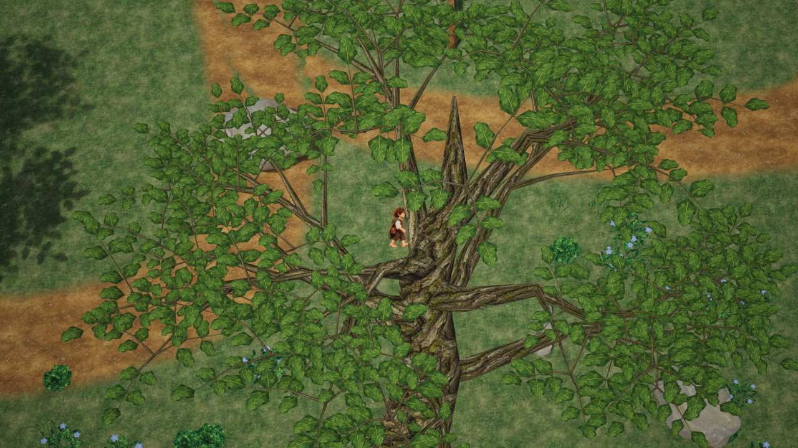
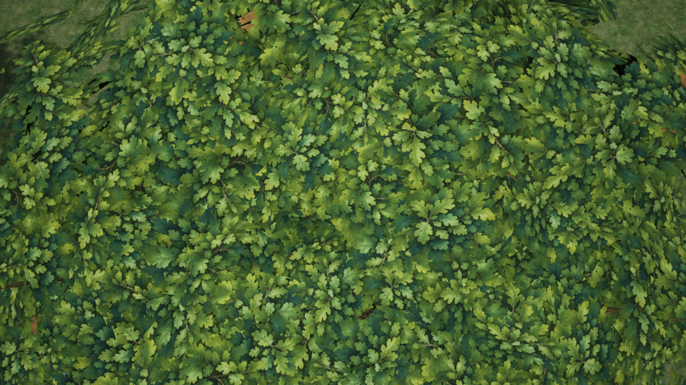
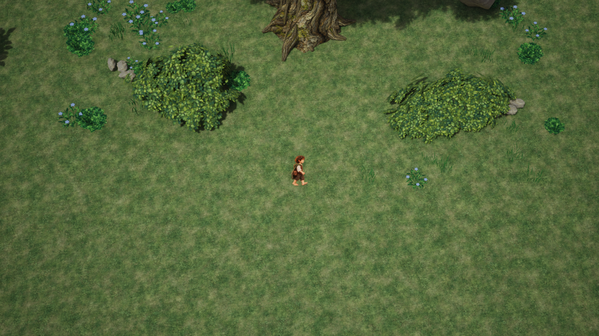
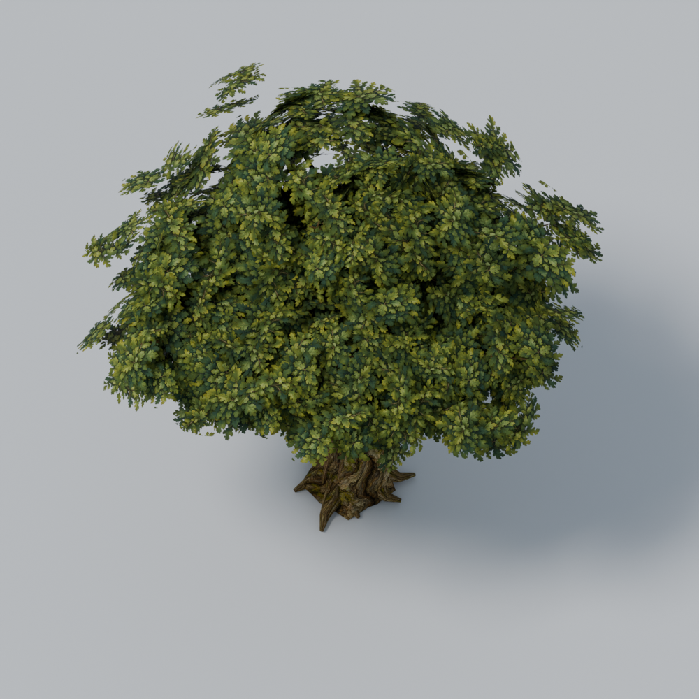
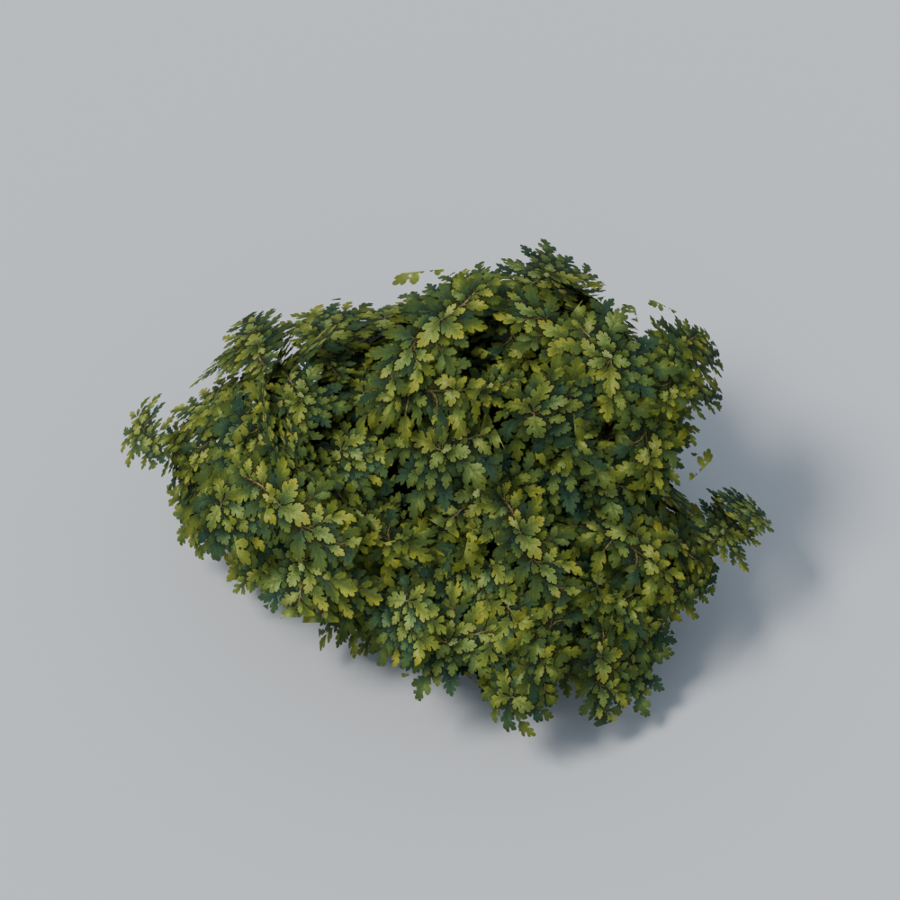
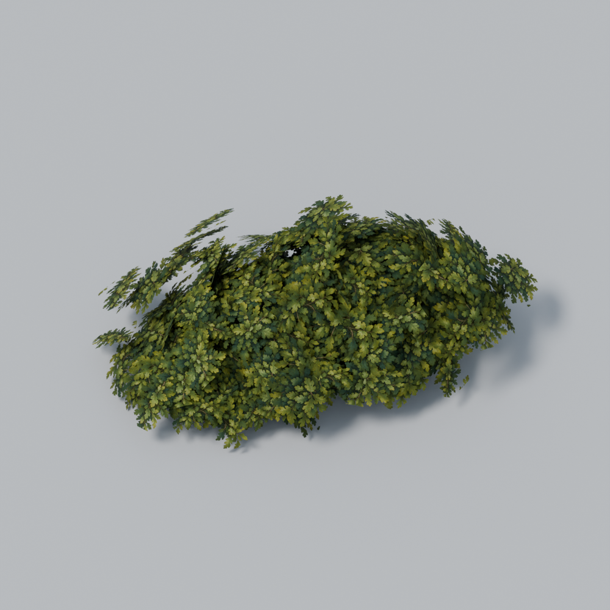

# Westland Asset Library – Art Quality V3 – Prüfbericht

Stand: 11.10.2026. Ausgangs-HEAD: `5f5711ddb98c0b5604c8b51b0713be95ea3fb358` – `Complete Westland asset library V2 tools and documentation`.

## Ergebnis und Freigabegrenze

Arbeitsbaum anfangs sauber. V2-Assets waren unter `c55a79d`, die anschließenden Werkzeuge/Dokumente unter dem Ausgangs-HEAD gesichert. Genau **eine alte Eiche und zwei unterschiedliche Wildstrauchvarianten** wurden als neue V3-Assets erstellt, gespeichert, erneut geöffnet, exportiert, importiert und in der vorhandenen Bibliotheksmap geprüft. Die ursprünglichen V1/V2-Dateien bleiben unverändert.

Die Krone und Sträucher sind deutlich dichter, kleinteiliger und malerischer als V2. Technische Prüfung, vollständiger Enhanced-Input-Fußlauf, Map Check und 38/38 vorhandene Automationstests bestanden. Das ist eine visuell geprüfte Art-Revision, **keine finale menschliche Art-Freigabe und keine Freigabe zur großflächigen Regionsverteilung**. Besonders die Verdeckung der Spielfigur unmittelbar unter der alten Eichenkrone bleibt offen. Dieser Bericht trennt diese Sichtabweichung ausdrücklich von funktionierenden Laufwegen und Collision.

## Vorgaben und unveränderte Bereiche

Gelesen: AGENTS, relevante TECHNIK/ENTSCHEIDUNGEN/GRAFIKSTIL, Spiel-/Stilgrundlagen und der vollständige V2-Prüfbericht. Maßgebliche Bildreferenz: `Art/World/WestlandRegion/RegionReference.png`, zusammen mit der dokumentierten handgemalten Fantasywelt und dem Heilhaus. Keine Marketplace-Assets, externen Downloads oder neuen Plugins.

Unverändert: Playerkörperhöhe 1,40 m, Actor Scale 1, bestehende Sprite-/Animationszuweisung, Bewegung 210 cm/s, acht Richtungen, Kamera 2500 cm / Pitch −55° / Yaw −45° / FOV 35°, Lag 12 / maximal 45 cm, Perspektive und deaktivierte Kamerakollision. Kein C++, Config-, Blueprint-, Input- oder Gameplay-Code geändert; kein Build erforderlich. `Dev_WestlandRegion`, `Dev_TestMap`, Heilhaus und andere Maps bleiben bytegleich.

Die normale geöffnete Blender-Szene mit Cube/Light/Camera wurde nicht ersetzt. Modellierung, Reopen-Prüfung und Export liefen in separaten Blender-Hintergrundprozessen mit zwei Threads. Separate Quelle: [WestlandAssetLibrary_V3.blend](../Art/World/WestlandAssetLibrary/Source/WestlandAssetLibrary_V3.blend). Neue aktive Quellszene `WestlandAssetLibrary_V3_Source`; einzelne Varianten liegen für den Export am Ursprung. Sträucher sind dort zunächst verborgen, damit sie nicht mit der Eiche überlappen; über den Outliner einzeln einblenden. Die übernommenen V2-Daten bleiben in der neuen Datei erhalten, die ursprüngliche V2-Datei selbst wird nicht gespeichert.

## Tatsächlich überarbeitete Modelle

| Modell | Form-/Oberflächenänderung | Beurteilung |
| --- | --- | --- |
| `SM_WLA_OakAncient_V3` | Gedrehter kräftiger Stamm, unregelmäßige Verzweigungen, ausgeprägte Wurzelanläufe/Rindenrippen, zurückhaltende Moos-/Farbvariation. Sieben überlagerte Kronenvolumen aus gekrümmten Blattgruppenkarten statt sichtbaren Kugelkörpern und großen Einzelblättern. | Geschlossene, asymmetrisch gelappte Krone deutlich dichter als V2. In der Nahsicht einige Kartenränder und wiederholte Blattmuster erkennbar. Dichte Krone kann den Player vollständig verdecken. |
| `SM_WLA_WildBush_V3_A` | Höherer, ungleichmäßig gelappter Strauch; drei ineinandergreifende Volumen, verdeckte Zweige, gestaffelte kleinere Blattgruppen. | Gut lesbare, dichte Silhouette; deutlich weniger regelmäßige Einzelblattverteilung als V2. |
| `SM_WLA_WildBush_V3_B` | Niedriger, breiter und seitlich auslaufend; andere Volumen, Neigungen und Grünwerte als A. | Klar unterscheidbar von A, ruhiger bodennaher Rand. Größere flächige Wiederholung bleibt in Nahsicht möglich. |

Die erste V3-Review war noch zu gleichmäßig/rund und die Blattgruppen zu weit auseinander. Nach Sichtprüfung wurden Volumenverteilung, Gruppendichte, Kartenkrümmung und Überlappung überarbeitet. Zweite Prüfung erfolgte am tatsächlich importierten Ergebnis. Keine fehlende Qualität durch zusätzliche Objekttypen oder höhere Polygonzahl kaschiert.

### Geometrie, Maßstab und LODs

Lokale Bounds X × Y × Z in Metern, Scale 1; keine Gleichsetzung von Kronen-Bounds und Collision. Alle sichtbaren Meshes haben ihren unteren Punkt auf Z=0.

| Modell | Bounds m | V2 LOD0 | V3 LOD0/1/2 | Slots / belegte LOD0-Sektionen | Gemalte Blattgruppen | UCX |
| --- | --- | ---: | --- | --- | ---: | ---: |
| Alte Eiche | 12,592 × 10,435 × 11,947 | 36264 | 12068 / 7240 / 3621 | 2 / 2 | 957 | 1 |
| Strauch A | 3,424 × 2,410 × 2,031 | 7398 | 3284 / 1971 / 986 | 2 / 2 | 352 | 0 |
| Strauch B | 3,883 × 2,150 × 1,417 | 7398 | 3396 / 2038 / 1019 | 2 / 2 | 366 | 0 |

Summe der drei LOD0-Meshes: **18748 statt 51060 Dreiecke, −63,28 %**. Blattkarten besitzen jeweils acht Dreiecke und repräsentieren viele kleine Blätter, keine einzelnen übergroßen Blätter. Drei LODs, ScreenSize 1 / 0,4 / 0,15, MikkTSpace. Fern-LOD-Popping und eine große zusammenhängende Waldverteilung sind nicht vollständig visuell freigegeben.

## Materialien und Texturen

- Bestehendes `T_WLA_Bark.png` und Unreal-Instanz `MI_WLA_Bark` wiederverwendet; keine gemeinsame Materialdatei überschrieben. Die neue Blender-Rindeninstanz nutzt gemalte Vertex-Farbvariation.
- Neuer eigener RGBA-Atlas `T_WLA_FoliageGroups_V3.png`: 1254 × 1254 Pixel, vier gemalte Blattgruppenausschnitte, echte transparente Ränder, natürliche Olive-/Moos-/Salbeitöne. Erzeugt mit dem eingebauten Imagegen-Werkzeug, keine externen Quellen. Vollständiger Prompt/Herkunft: [TextureProvenance_V3.md](../Art/World/WestlandAssetLibrary/TextureProvenance_V3.md).
- Unreal baut daraus eine **2048 × 2048** Laufzeittextur mit Mips, Streaming und Alpha-Coverage-Skalierung zur Clipgrenze 0,45. Die ursprüngliche PNG-Datei wird nicht umgerechnet/überschrieben. Kein behaupteter exakter GPU-Speicherverbrauch ohne Resource-Counter.
- Neue Familie `M_WLA_FoliageGroups_V3` / `MI_WLA_FoliageGroups_V3`: **Masked, TwoSided, Clip 0,45**, ein Farbtextur-Sample, Vertexfarbe/Tint, Roughness 0,95, Specular 0,05. Keine Translucent-Blätter, Wind-/Ticklogik, zusätzlichen Mikro-Normalmaps oder Hochglanzoberflächen.
- UV0 nutzt bewusst wiederholte/überlagerte Atlas- und Rindenkoordinaten. Keine singulären UV-Dreiecke. Lightmap-Generierung beim Import angefordert; der tatsächliche Audit sieht einen Quell-UV-Kanal. Ein eindeutiger separat geprüfter Bake-UV1-Unwrap wird nicht behauptet; die Prüfszene nutzt dynamische Beleuchtung.

## Vergleichsmap und Waldszene

Nur `/Game/Maps/Dev_WestlandAssetLibrary` geändert. Die vorhandene Übersicht bleibt erhalten. Ergänzt wurden **16 Actors**: drei V2-Vergleichsinstanzen, drei V3-Instanzen, drei vorhandene Felsen, drei vorhandene Steincluster, ein eigenes geschwungenes Wegband und drei HISM-Träger. Keine neue Gameplayklasse.

Die zwei Vergleichsgruppen liegen nebeneinander. Neue Eiche bei E=10/N=−13 m, Sträucher bei 6,5/−16 und 14/−16,5 m. E/N bezeichnet Bildschirm-Rechts/Vorwärts-Basis der unveränderten Kamera, nicht Unreal-Welt-X/Y. Exakte Welttransforms und Verteilung stehen im lokalen `Saved/WestlandAssetLibraryV3/MapLayout.json` und im reproduzierbaren Autorenwerkzeug.

Weg nominal 2,4 m breit, organische Kurven und vorhandenes Gras-/Erde-Blendmaterial; 1512 Dreiecke, keine Collision/Schatten. 35 Gras-, 20 Wildblumen- und 12 Kräuterinstanzen, **67 Instanzen auf drei HISM-Komponenten**, ohne Player-Collision/Schatten; Culling 6000–8000 cm. Gruppierte Verteilung mit freier Wegmitte statt Raster. Große neue Vergleichsobjekte bis 10000 cm Sichtweite. Keine Behauptung, dass zwei Materialsektionen einem einzigen gemessenen Draw Call entsprechen.

### Bildnachweise

**Identische tatsächliche Spielkamera und Playerposition**, ausschließlich die drei Laufzeitmeshes getauscht. Beide Aufnahmen 1280 × 720, kein Blender-/Editorperspektiv-Ersatz. Native Messviewporthöhe 740 Pixel; beide Captures verwenden identische 720-Pixel-Ausgabe. Der Blick ist bewusst eine nahe, kronenfüllende Ansicht: Sie zeigt den Dichteunterschied und auch die Verdeckung.

| V2 | V3 |
| --- | --- |
|  |  |



Die folgende **Blender-Silhouettenprüfung** verwendet eine an das gesamte Objekt angepasste orthografische Kamera mit −55° und zeigt daher die vollständige Eiche. Sie ist ausdrücklich **keine** Aufnahme der unveränderten Spielkamera.



| Höherer Strauch A | Niedriger Strauch B |
| --- | --- |
|  |  |

Selbstkritischer Vergleich: Dichte und Blattmaßstab sind klar näher an der gemalten Referenz, Äste/Wurzeln organischer und die zwei Strauchsilhouetten unterschiedlich. Die Illustration hat weiterhin stärker artgerichtete Kronenränder, größere botanische Vielfalt und weichere Lichtmodellierung. Der vorhandene Testmap-Boden und die Beleuchtung werden nicht als Teil dieses Dreimodell-Passes global umgebaut. Große Strauchbestände und Fernansichten sind noch kein vollständig geprüftes Regionsszenario.

## Technische Korrekturen und Prüfungen

1. **Blender-Reopen:** Gespeicherte V3-Quelle erneut geöffnet, ohne Resave im Review. Drei Meshes jeweils 0 ungültige UV-Dreiecke, 0 ungültige Corner-Normalen, 0 ungültige Tangenten/Binormalen und 0 degenerierte Flächen. Ursprünge, Scale, Bounds und Materialien geprüft.
2. **Export/Import:** Drei getrennte FBX mit echten Normalen/Tangenten. Unreal importiert beides für LOD0; MikkTSpace-Rahmen der reduzierten LODs werden neu berechnet. Finaler Import enthält keine Normalen-/Binormalenwarnungen für die drei Modelle. Keine Warnungsunterdrückung.
3. **Eigener Weg:** Erstaufbau meldete fast-null Normalen/Binormalen. Ursache: 16 umgekehrte Dreiecke an engen Bandkurven, gegensinnige gemittelte Normalen und nicht aktivierte Tangentenberechnung. Jede Fläche nun konsistent aufwärts, explizite Normalen und Tangentenbildung. Finaler Neubuild ohne diese Warnungen; Form, Breite und Collision bleiben erhalten.
4. **Stamm-Collision:** Beim ersten Übernehmen eines alten Hull-Meshdatablocks ging dessen Objektversatz verloren. Nach tatsächlicher Prüfung durch einen eigenen geerdeten, konischen UCX-Körper ersetzt: **1,74 × 1,70 × 4,80 m**, unten Z=0, oben 4,80 m. PIE-Capsule-Sweeps blockieren den Stamm in beiden Weltachsen sowie auf 350 cm Höhe. Sträucher blockieren nicht; keine Kronen-Collision.
5. **Fußblockade:** Erster Lauf blieb am neu platzierten Felsen am Rückweg hängen. Nur diesen neuen Felsen von E7/N−9,5 nach E7/N−5,8 versetzt. Danach vollständige Läufe erfolgreich. Keine bestehende Collision oder Bewegungslogik verändert.
6. **PIE final:** **83,176 m / 51,039 Spielsekunden**, Start → V2-Vergleich → Waldweg → beide Sträucher → nördlicher Weg → Stamm von allen Seiten umrunden → Rückweg → Start. Enhanced Input, alle acht Richtungen, **keine Test-Teleports**. Alle Wegpunkte geerdet, keine Map-Lücke/Fallstelle, kein blockierter Abschnitt. Inventarmenü sperrt und gibt Steuerung korrekt zurück. Sichtbarkeit unmittelbar unter der Krone ausdrücklich nicht überall bestanden.
7. **Map Check:** Finale gespeicherte Bibliotheksmap **0 Fehler / 0 Warnungen**.
8. **Automation:** Native MCP-Discovery in dieser Editorsitzung, danach `StartsWith:PokeMonster`: **38/38 Success**, keine Testfehler/Testwarnungen. Player Foundation/Scale/Building Camera, Battle, Capture, Encounter, Inventory, Save, Quest, Dialog, HUD, RestPoint/Checkpoint und Healing House eingeschlossen. Keine neuen C++-Tests erforderlich; neue Asset-/Collision-Audits liegen in den Python-Werkzeugen.
9. **Runtime-Erhaltung:** Nutzer-Dev-Spielstand vor/nach Tests SHA256-identisch. Testqualitätswerte, CPU-Drosselung und PIE-Fensterpräferenzen auf ursprüngliche Werte zurückgegeben; PIE und eigene Testcallbacks/UI-Beobachter beendet. Zwei von Automation erzeugte transiente `/Temp/Untitled_*`-Packages sind nicht als Projektdateien gespeichert. Kein anderer Content-Package verbleibt dirty.
10. **Warnungsgrenze:** Vorhandene Engine-/iOS-Hilfstoolwarnungen (`idevice_id`, Bad CPU type) bestehen unabhängig weiter. „Keine Normalenwarnungen im finalen Build“ bedeutet nicht „keine einzige Warnung im gesamten historischen Editorlog“.

## Performance: überprüfter V2/V3-Vergleich

MacBook Air M4 / 16 GB, UE 5.8.2 Metal, Editor-PIE. Gleiche laufende Welt, derselbe **zu Fuß erreichte** Playerstandort (119,748 / 1263,443 / 50,000 cm), unveränderte Kamera. Nur die drei V3-Vergleichskomponenten tauschen gegen V2; übrige Map, Unterwuchs, Licht und Hintergrund identisch. Beide Varianten temporär Movable, damit Unreal den Meshtausch zulässt; ursprüngliche Mobilität/Overrides/Shadow/Sichtbarkeit/Meshes anschließend zurückgegeben. Die gespeicherte Map bleibt statisch.

Tatsächlicher Viewport **1280 × 740**, alle sg-Gruppen Medium/1, Renderauflösung 75 %, VSync aus, uncapped. CPU-Drosselung aus, zweiter Editorviewport ohne Realtime. **10 s Warmup + 30 s CSV**, Screenshot vor dem Capture. Kein Blender-Render oder Automationstest während der Messung. Auf der endgültigen Map nach Weg-Normalenkorrektur nochmals V2/V3 gemessen.

| Finale Messung | Frames | FPS aus FrameTime | Frame ms | GameThread ms | GPU ms | ShadowDepths ms | ShadowProjection ms | Basepass ms |
| --- | ---: | ---: | ---: | ---: | ---: | ---: | ---: | ---: |
| V2 | 976 | **32,52** | 30,75 | 7,69 | 27,06 | 2,25 | 0,68 | 1,65 |
| V3 | 963 | **32,08** | 31,17 | 7,88 | 27,59 | 2,15 | 0,73 | 0,92 |

Finales Delta etwa **+0,42 ms FrameTime / +0,53 ms GPU**, ca. −1,34 % FPS. **Kein deutlicher Performancegewinn nachgewiesen**, trotz deutlich weniger Dreiecken. Die frühere ABBA-Wiederholung am selben Standort lag für V2 zwischen 31,02–33,24 FPS und für V3 bei 30,75–30,83 FPS; normale Lauf-/Editor-/Thermikschwankung verhindert die Interpretation kleiner Differenzen als feste isolierte Assetkosten. Die drei Hauptmeshes, Zahl belegter Sektionen und Positionen sind pro Capture protokolliert.

Der allererste Vergleich war **ungültig**: Unreal lehnte `SetStaticMesh` auf statischen Laufzeitkomponenten ab, wodurch beide Screens V3 zeigten. Nach Gegenprüfung von Bildern/Logs wurde das Werkzeug korrigiert: für beide Varianten dieselbe temporäre Mobilität, Rückgabewert und tatsächliche Mesh-/Materialreferenzen prüfen. Diese ungültigen Captures wurden separat markiert und nicht ausgewertet.

### Renderingdiagnosen, ausschließlich temporär

Diese Diagnosen gehören zur ABBA-Serie vor der abschließenden Weg-Tangentenreparatur. Der Weg hatte bereits dieselben Positionen, Dreieckzahlen, Materialien und keine Schatten/Collision. Die finale V2/V3-Messung oben verwendet den reparierten Stand. Diagnosen ändern niemals gespeicherte Qualität oder Assetmaterialien.

| Diagnose | FPS | Frame ms | GameThread ms | GPU ms | ShadowDepths ms | ShadowProjection ms | Basepass ms |
| --- | ---: | ---: | ---: | ---: | ---: | ---: | ---: |
| V3, beide Wiederholungen | 30,75 / 30,83 | 32,52 / 32,44 | 8,79 / 8,56 | 28,15 / 27,79 | 1,99 / 2,19 | 1,10 / 1,09 | 0,91 / 0,86 |
| Schatten nur der drei neuen Modelle aus | 32,72 | 30,57 | 7,42 | 26,92 | 2,07 | 0,73 | 0,87 |
| Nur diese drei Modelle verborgen | 30,32 | 32,99 | 10,36 | 28,25 | 2,17 | 0,77 | 1,59 |
| Transienter Opaque-Blattshader statt Masked | 33,12 | 30,19 | 7,68 | 26,08 | 2,04 | 0,85 | 0,73 |

- **GPU/Editorkosten dominieren:** GameThread ungefähr 7–10 ms, GPU ca. 26–28 ms. `GPU/SlateUI` in dieser Serie ca. 7,7–8,5 ms; `GPU/Unaccounted` ca. 5,5–6,9 ms. Editor-Oberfläche ist ein wesentlicher Beitrag. Unaccounted ist keine belastbar zuordenbare Vegetationskostenstelle.
- **Schatten:** Die neue Schattenabschaltung reduziert ShadowProjection in dieser Serie von etwa 1,1 auf 0,73 ms. Der gesamte ShadowDepths-Pass bleibt um 2 ms, da andere Bibliotheksobjekte weiterhin Schatten werfen. Keine permanente Schattenabschaltung beschlossen.
- **Masked/Überdeckung:** Opake Diagnose zeigt tatsächlich ungeeignete dunkle Kartenrechtecke und erzielt geringere GPU-Zeit. Sie verändert zugleich Deckung/Früh-Z/Verdeckung des Hintergrunds. Das ist ein Hinweis auf Karten-/Alpha-Test-Kosten, **keine exakt isolierte Masked-Kostenmessung** und kein visuell akzeptabler Ersatzshader.
- **Verborgene Vegetation:** Gesamtszene wird nicht automatisch schneller, weil vorher verdeckte Hintergrundobjekte sichtbar werden und CPU-/GPU-Last schwankt. Der höhere Basepass zeigt diese Änderung. Daraus darf nicht „Vegetation kostet 0 ms“ abgeleitet werden.
- **Draw Calls/RenderThread:** CSV-Zähler `RHI/DrawCalls`, `RHI/PrimitivesDrawn`, `RenderThreadTime` liefern in dieser Metal-Capture nur 0; **nicht zuverlässig verfügbar**, keine echten Nullkosten. Zwei Sektionen je Mesh entsprechen sechs Meshsektionen für die drei Modelle vor zusätzlichen Passes/LODs, nicht sechs gemessenen Frame-Draw-Calls. Kein erneuter Einsatz des früher abstürzenden Primitive-Debuggers.
- Die historischen 53,20 PIE-Start / 59,70 Standalone-Start / 37,94 Wald-FPS stammen aus anderen Blickpunkten und V2-Mapzuständen. Sie sind **kein** frischer A/B-Beleg. Dieser Auftrag prüft V2/V3 in identischem Editor-PIE; kein neuer identischer Standalone-V3-Vergleich oder Shipping-/große-Region-Nachweis wird behauptet.

Rohdaten lokal: `Saved/Profiling/CSV/WLA_V3_*.csv`, Performance-/Kamera-/Meshprotokolle und `RenderingCosts.json` unter `Saved/WestlandAssetLibraryV3`. Ungültige Messungen enthalten `InvalidStaticSwap` und werden vom Summarizer ausgeschlossen.

## Verbleibende Art-/Performanceabweichungen

1. **Figurverdeckung:** Die neue ca. 12 m hohe und breite Krone füllt die unveränderte Kamera bei unmittelbarer Nähe und verdeckt die Figur. Waldweg/Collision bleiben begehbar. Für späteren Regionseinsatz sind artgerichtete Platzierung freier Laufzonen und gegebenenfalls eine separat beauftragte Vegetations-Sichtlösung nötig; keine neue Fade-/Gameplaylogik in dieser Aufgabe.
2. Vier Atlasgruppen reichen für diesen Prototyp, stellenweise bleiben wiederholte Gruppen und Kartenkanten sichtbar. Kronenränder/kleine abgesetzte Sprays sind noch weniger artgerichtet als die Illustration; Stammrindenkontrast ebenfalls kräftiger.
3. V3-A/B funktionieren einzeln und gemeinsam am Weg; große homogene Strauchgruppen wurden nicht als vollständiges Regionsszenario freigegeben. Weitere botanische Typen wurden nicht ergänzt.
4. Automatisch reduzierte LODs sind technisch vorhanden; vollständige Fern-LOD-/Poppingprüfung und große Waldinstancing-/Schattenbudgets bleiben offen.
5. Keine stabilen 60 FPS, keine exakten Draw Calls, keine direkte Hochrechnung auf 800 × 600 m. Keine permanente pauschale Qualitätsabsenkung und keine Performancefreigabe allein aufgrund der Polygonreduktion.

## Werkzeuge und Wiederholung

`BuildWestlandAssetLibraryV3.py` → Quelle speichern → `ReviewWestlandAssetLibraryV3.py` erneut öffnen/prüfen/rendern → bewusste Sichtprüfung → `ExportWestlandAssetLibraryV3.py` → `ImportWestlandAssetLibraryV3.py` → `DressWestlandAssetLibraryV3.py` → `ValidateWestlandAssetLibraryV3.py` → PIE-Fußlauf/gleicher Standort → `MeasureWestlandAssetLibraryV3.py` → `SummarizeWestlandAssetLibraryV3.py`. Blender mit `-b <Quelle> -t 2 --python <Werkzeug>`; Review kann `-- --audit-only` verwenden.

Export verlangt den lokalen expliziten Reviewnachweis `ArtReviewAccepted.json`; er ist eine Agent-Sichtprüfung, keine menschliche Freigabe. Foot-/Performance-Jobdateien und Editorqueue sind lokale Arbeitsartefakte im ignorierten Saved-Ordner. Änderungen am Editor werden nur nach vorheriger Prüfung auf ungesicherte Nutzerpackages ausgeführt. Alte Modelle/Actors werden nicht gelöscht; Map-Wiederholung aktualisiert nur die eigenen `V3_*`-Instanzen.

## Dateien, Git und Sicherungspunkt

Vollständige abschließende Dateiliste unten. Rohlogs, Testsave-Backups, temporäre Reviewstände und Diagnose-Captures unter `Saved/` gehören nicht in den Commit. Ausgewählte sechs unveränderte Bildnachweise unter `Art/.../Review/V3` gehören als dauerhafter Artvergleich zur Revision.

Kein Commit, Push, Restore, Löschen oder Staging ausgeführt. Nach Harrys Sichtprüfung ist die zusammenhängende Art-/Testmap-/Werkzeugrevision ein sinnvoller Git-Sicherungspunkt; keine automatische finale Regionsintegration.

### Geänderte bestehende Dateien (3)

- `Content/Maps/Dev_WestlandAssetLibrary.umap`
- `Docs/ENTSCHEIDUNGEN.md`
- `Docs/TECHNIK.md`

### Neue Dateien (30)

- `Art/World/WestlandAssetLibrary/ArtQualityV3.json`
- `Art/World/WestlandAssetLibrary/Exports/V3/SM_WLA_OakAncient_V3.fbx`
- `Art/World/WestlandAssetLibrary/Exports/V3/SM_WLA_WildBush_V3_A.fbx`
- `Art/World/WestlandAssetLibrary/Exports/V3/SM_WLA_WildBush_V3_B.fbx`
- `Art/World/WestlandAssetLibrary/Review/V3/Blender_Bush_A.png`
- `Art/World/WestlandAssetLibrary/Review/V3/Blender_Bush_B.png`
- `Art/World/WestlandAssetLibrary/Review/V3/Blender_Oak_Silhouette.png`
- `Art/World/WestlandAssetLibrary/Review/V3/GameCamera_FinalV2.png`
- `Art/World/WestlandAssetLibrary/Review/V3/GameCamera_FinalV3.png`
- `Art/World/WestlandAssetLibrary/Review/V3/GameCamera_Forest.png`
- `Art/World/WestlandAssetLibrary/Source/WestlandAssetLibrary_V3.blend`
- `Art/World/WestlandAssetLibrary/TextureProvenance_V3.md`
- `Art/World/WestlandAssetLibrary/Textures/T_WLA_FoliageGroups_V3.png`
- `Content/Environment/WestlandAssetLibrary/QualityV3/Materials/MI_WLA_FoliageGroups_V3.uasset`
- `Content/Environment/WestlandAssetLibrary/QualityV3/Materials/M_WLA_FoliageGroups_V3.uasset`
- `Content/Environment/WestlandAssetLibrary/QualityV3/Meshes/Review/SM_WLA_V3_ForestPath.uasset`
- `Content/Environment/WestlandAssetLibrary/QualityV3/Meshes/Trees/SM_WLA_OakAncient_V3.uasset`
- `Content/Environment/WestlandAssetLibrary/QualityV3/Meshes/Vegetation/SM_WLA_WildBush_V3_A.uasset`
- `Content/Environment/WestlandAssetLibrary/QualityV3/Meshes/Vegetation/SM_WLA_WildBush_V3_B.uasset`
- `Content/Environment/WestlandAssetLibrary/QualityV3/Textures/T_WLA_FoliageGroups_V3.uasset`
- `Docs/WESTLAND_ASSET_LIBRARY_ART_QUALITY_V3_PRUEFBERICHT.md`
- `Tools/Blender/BuildWestlandAssetLibraryV3.py`
- `Tools/Blender/ExportWestlandAssetLibraryV3.py`
- `Tools/Blender/ReviewWestlandAssetLibraryV3.py`
- `Tools/DressWestlandAssetLibraryV3.py`
- `Tools/ImportWestlandAssetLibraryV3.py`
- `Tools/MeasureWestlandAssetLibraryV3.py`
- `Tools/SummarizeWestlandAssetLibraryV3.py`
- `Tools/TestWestlandAssetLibraryV3PIE.py`
- `Tools/ValidateWestlandAssetLibraryV3.py`

### Erhaltung und Abschlusschecks

Von 1343 anfangs versionierten Dateien sind 1340 bytegleich; nur die drei oben genannten bestehenden Dateien geändert. Insbesondere V1-/V2-Blender, alte Exporte/Unreal-Assets, alle Source-/Config-Dateien, Region und andere Maps sind bytegleich. Kein ursprünglicher Pfad fehlt. Originaler Dev-Spielstand SHA256-identisch.

`git diff --check`: erfolgreich, keine Ausgabe. Zusätzliche Markdownprüfung auf abschließende Leerzeichen, unpaarige Codefences und gebrochene lokale Bild-/Dateilinks sowie Syntaxprüfung aller neun neuen Python-Werkzeuge bestanden.

### Exaktes git status --short --untracked-files=all

```text
 M Content/Maps/Dev_WestlandAssetLibrary.umap
 M Docs/ENTSCHEIDUNGEN.md
 M Docs/TECHNIK.md
?? Art/World/WestlandAssetLibrary/ArtQualityV3.json
?? Art/World/WestlandAssetLibrary/Exports/V3/SM_WLA_OakAncient_V3.fbx
?? Art/World/WestlandAssetLibrary/Exports/V3/SM_WLA_WildBush_V3_A.fbx
?? Art/World/WestlandAssetLibrary/Exports/V3/SM_WLA_WildBush_V3_B.fbx
?? Art/World/WestlandAssetLibrary/Review/V3/Blender_Bush_A.png
?? Art/World/WestlandAssetLibrary/Review/V3/Blender_Bush_B.png
?? Art/World/WestlandAssetLibrary/Review/V3/Blender_Oak_Silhouette.png
?? Art/World/WestlandAssetLibrary/Review/V3/GameCamera_FinalV2.png
?? Art/World/WestlandAssetLibrary/Review/V3/GameCamera_FinalV3.png
?? Art/World/WestlandAssetLibrary/Review/V3/GameCamera_Forest.png
?? Art/World/WestlandAssetLibrary/Source/WestlandAssetLibrary_V3.blend
?? Art/World/WestlandAssetLibrary/TextureProvenance_V3.md
?? Art/World/WestlandAssetLibrary/Textures/T_WLA_FoliageGroups_V3.png
?? Content/Environment/WestlandAssetLibrary/QualityV3/Materials/MI_WLA_FoliageGroups_V3.uasset
?? Content/Environment/WestlandAssetLibrary/QualityV3/Materials/M_WLA_FoliageGroups_V3.uasset
?? Content/Environment/WestlandAssetLibrary/QualityV3/Meshes/Review/SM_WLA_V3_ForestPath.uasset
?? Content/Environment/WestlandAssetLibrary/QualityV3/Meshes/Trees/SM_WLA_OakAncient_V3.uasset
?? Content/Environment/WestlandAssetLibrary/QualityV3/Meshes/Vegetation/SM_WLA_WildBush_V3_A.uasset
?? Content/Environment/WestlandAssetLibrary/QualityV3/Meshes/Vegetation/SM_WLA_WildBush_V3_B.uasset
?? Content/Environment/WestlandAssetLibrary/QualityV3/Textures/T_WLA_FoliageGroups_V3.uasset
?? Docs/WESTLAND_ASSET_LIBRARY_ART_QUALITY_V3_PRUEFBERICHT.md
?? Tools/Blender/BuildWestlandAssetLibraryV3.py
?? Tools/Blender/ExportWestlandAssetLibraryV3.py
?? Tools/Blender/ReviewWestlandAssetLibraryV3.py
?? Tools/DressWestlandAssetLibraryV3.py
?? Tools/ImportWestlandAssetLibraryV3.py
?? Tools/MeasureWestlandAssetLibraryV3.py
?? Tools/SummarizeWestlandAssetLibraryV3.py
?? Tools/TestWestlandAssetLibraryV3PIE.py
?? Tools/ValidateWestlandAssetLibraryV3.py
```

### Empfohlenes Staging nach Sichtprüfung, nicht ausgeführt

```bash
git add -- \
  Content/Maps/Dev_WestlandAssetLibrary.umap \
  Docs/ENTSCHEIDUNGEN.md \
  Docs/TECHNIK.md \
  Art/World/WestlandAssetLibrary/ArtQualityV3.json \
  Art/World/WestlandAssetLibrary/Exports/V3/SM_WLA_OakAncient_V3.fbx \
  Art/World/WestlandAssetLibrary/Exports/V3/SM_WLA_WildBush_V3_A.fbx \
  Art/World/WestlandAssetLibrary/Exports/V3/SM_WLA_WildBush_V3_B.fbx \
  Art/World/WestlandAssetLibrary/Review/V3/Blender_Bush_A.png \
  Art/World/WestlandAssetLibrary/Review/V3/Blender_Bush_B.png \
  Art/World/WestlandAssetLibrary/Review/V3/Blender_Oak_Silhouette.png \
  Art/World/WestlandAssetLibrary/Review/V3/GameCamera_FinalV2.png \
  Art/World/WestlandAssetLibrary/Review/V3/GameCamera_FinalV3.png \
  Art/World/WestlandAssetLibrary/Review/V3/GameCamera_Forest.png \
  Art/World/WestlandAssetLibrary/Source/WestlandAssetLibrary_V3.blend \
  Art/World/WestlandAssetLibrary/TextureProvenance_V3.md \
  Art/World/WestlandAssetLibrary/Textures/T_WLA_FoliageGroups_V3.png \
  Content/Environment/WestlandAssetLibrary/QualityV3/Materials/MI_WLA_FoliageGroups_V3.uasset \
  Content/Environment/WestlandAssetLibrary/QualityV3/Materials/M_WLA_FoliageGroups_V3.uasset \
  Content/Environment/WestlandAssetLibrary/QualityV3/Meshes/Review/SM_WLA_V3_ForestPath.uasset \
  Content/Environment/WestlandAssetLibrary/QualityV3/Meshes/Trees/SM_WLA_OakAncient_V3.uasset \
  Content/Environment/WestlandAssetLibrary/QualityV3/Meshes/Vegetation/SM_WLA_WildBush_V3_A.uasset \
  Content/Environment/WestlandAssetLibrary/QualityV3/Meshes/Vegetation/SM_WLA_WildBush_V3_B.uasset \
  Content/Environment/WestlandAssetLibrary/QualityV3/Textures/T_WLA_FoliageGroups_V3.uasset \
  Docs/WESTLAND_ASSET_LIBRARY_ART_QUALITY_V3_PRUEFBERICHT.md \
  Tools/Blender/BuildWestlandAssetLibraryV3.py \
  Tools/Blender/ExportWestlandAssetLibraryV3.py \
  Tools/Blender/ReviewWestlandAssetLibraryV3.py \
  Tools/DressWestlandAssetLibraryV3.py \
  Tools/ImportWestlandAssetLibraryV3.py \
  Tools/MeasureWestlandAssetLibraryV3.py \
  Tools/SummarizeWestlandAssetLibraryV3.py \
  Tools/TestWestlandAssetLibraryV3PIE.py \
  Tools/ValidateWestlandAssetLibraryV3.py
git diff --cached --stat
```
